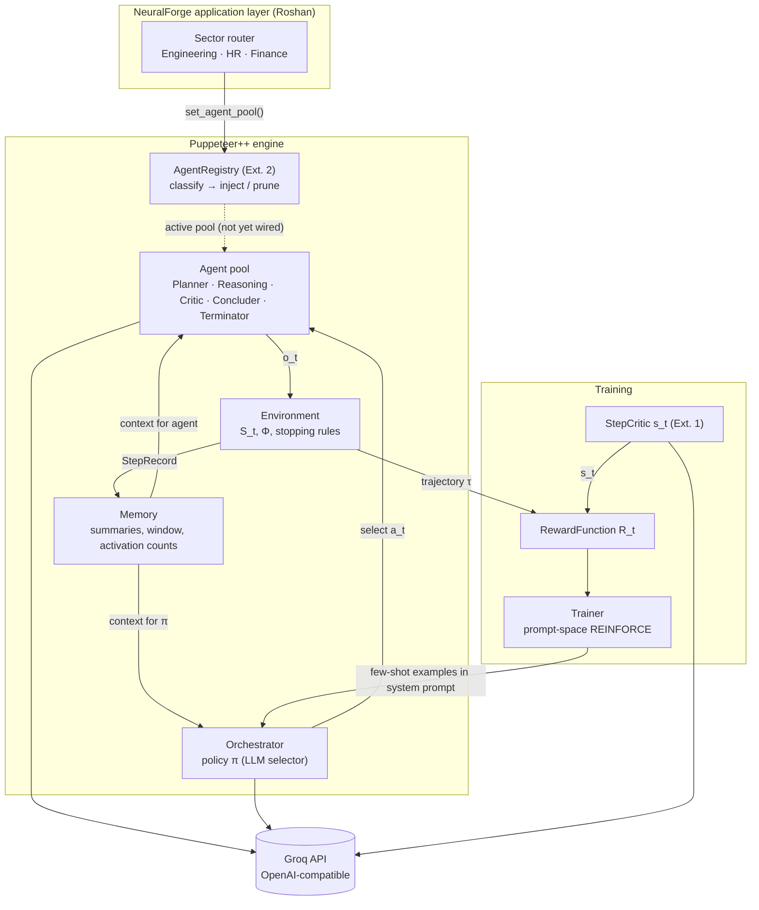
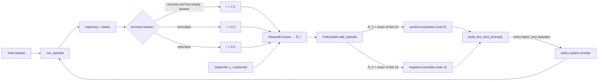

# Puppeteer++
### Adaptive Multi-Agent Orchestration with an Evolving Topology

> Built on *"Multi-Agent Collaboration via Evolving Orchestration"* (NeurIPS 2025),
> re-implemented from scratch in Python and extended with dense step-level rewards,
> dynamic agent injection, and a prompt-space policy optimiser.

**Authors:** Amal Tom Ajith (core engine & research extensions) · Roshan Joseph Thomas (NeuralForge application layer)
**Institution:** Dept. of CSE, CHRIST (Deemed to be University), Bengaluru, B.Tech 2023–2027

> **Continuing this project?** Start with [CLAUDE.md](CLAUDE.md), which covers the current
> state, the plan, setup and API keys. This README explains the theory and the results.

---

## Contents

1. [The idea in one paragraph](#1-the-idea-in-one-paragraph)
2. [Theory](#2-theory)
3. [Architecture](#3-architecture)
4. [How one episode runs, step by step](#4-how-one-episode-runs-step-by-step)
5. [Module reference](#5-module-reference)
6. [The reward function, worked example](#6-the-reward-function-worked-example)
7. [Training: how the puppeteer learns](#7-training-how-the-puppeteer-learns)
8. [Research extensions](#8-research-extensions)
9. [Benchmarks](#9-benchmarks)
10. [Setup, running and testing](#10-setup-running-and-testing)
11. [Implementation status](#11-implementation-status)
12. [Known limitations](#12-known-limitations)
13. [Roadmap](#13-roadmap)
14. [Application: Puppeteer-Code coding assistant](#14-application-puppeteer-code-coding-assistant)
15. [Citation](#15-citation)

---

## 1. The idea in one paragraph

Most multi-agent LLM systems wire agents into a **fixed pipeline**: every task goes
Planner → Coder → Reviewer → … whether it needs to or not. That wastes tokens on easy
tasks and cannot adapt on hard ones. The Puppeteer approach puts one **central
orchestrator** (the "puppeteer") in charge. At every step it looks at the current state
of the problem and picks **one** agent (a "puppet") to act next. The sequence of agents,
and so the team's topology, is not designed in advance. It **emerges per task**, and the
orchestrator's selection policy is **trained with reinforcement learning** to prefer
sequences that reach correct answers cheaply.

---

## 2. Theory

### 2.1 Agents as triples

An LLM agent is reduced to its minimal form:

$$a = (m,\ r,\ t)$$

| Symbol | Meaning | In code (`core/agent.py`) |
|---|---|---|
| $m$ | foundation model | `AgentConfig.model_name` (e.g. `openai/gpt-oss-20b`) |
| $r$ | reasoning pattern / role prompt | `AgentConfig.role_prompt` + the agent's `_build_action_prompt()` |
| $t$ | set of external tools | `AgentConfig.tools` (empty list = pure reasoning agent) |

Two agents with the same model but different prompts are **different agents**. The pool
$\mathcal{A} = \{a_1, \dots, a_n\}$ is what the puppeteer chooses from.

### 2.2 Orchestration as a sequential decision process

A task $\tau$ is solved over discrete steps $t = 0, 1, \dots, T$.

**Global state.** $S_t$ holds everything relevant up to step $t$: the task, each agent's
contribution so far, and aggregated context.

**Policy (who acts next).**

$$a_t \sim \pi_\theta(a \mid S_t,\ \tau)$$

**Agent action (what it produces).** The chosen agent sees its local slice of the state,
$s_t(a_t)$, and generates an output:

$$o_t = f_{a_t}\big(s_t(a_t),\ S_t\big)$$

**State transition.**

$$S_{t+1} = \Phi(S_t,\ o_t)$$

**Markov assumption.** The next choice depends only on the current state, not the full
path that produced it:

$$P(a_{t+1} \mid S_0, a_0, \dots, S_{t+1}, \tau) = P(a_{t+1} \mid S_{t+1}, \tau)$$

This is what lets us **bound** what the orchestrator reads: it needs a good summary of
$S_{t+1}$, not the raw transcript.

**Stopping.** The episode ends when a terminator agent is chosen, when a concluder
produces the final answer, when an agent fails, or when the step budget runs out.

**Final answer (aggregation).**

$$o^* = F_{agg}(\{o_0, \dots, o_T\})$$

**Trajectory.** One episode is the sequence

$$\tau_{ep} = \{S_0, a_0, o_0,\ S_1, a_1, o_1,\ \dots,\ S_T, a_T, o_T\}$$

### 2.3 Why "evolving topology"?

If you draw an edge $a_t \to a_{t+1}$ for every consecutive pair of activations, each
episode produces a graph. In a fixed pipeline that graph is always the same chain. Under a
learned policy it differs by task: short chains for easy tasks, loops such as
Reasoning → Critic → Reasoning for hard ones. The original paper reports that training
makes these graphs **more compact and more cyclic**: fewer agents, more focused
back-and-forth. That is the "evolution".

### 2.4 Reward: correct *and* cheap

Each step has a cost based on the tokens it used, $F_t$, scaled up for later steps:

$$C_t = F_t \cdot \log\!\left(1 + \frac{t}{\varphi}\right)$$

where $\varphi$ is the maximum episode length. Step 0 is free ($\log 1 = 0$). Later steps
cost more, which pushes the policy to finish early.

Rewards are computed **backwards** from the final step $T$:

$$
R_t =
\begin{cases}
r - \lambda \, C_T & t = T \\
\gamma \, R_{t+1} - \lambda \, C_t & t < T
\end{cases}
$$

- $r \in [0, 1]$: quality or correctness of the final answer
- $\lambda$: efficiency weight (default 0.1)
- $\gamma$: discount factor (default 0.99)

**Our extension (dense step reward).** A step critic scores each intermediate output
$s_t \in [0,1]$, and we add it to the non-terminal steps:

$$R_t = \gamma R_{t+1} - \lambda C_t + \beta\, s_t \qquad (t < T)$$

### 2.5 REINFORCE

The objective is expected return, $J(\theta) = \mathbb{E}_{\pi_\theta}[R(\tau)]$. Its
gradient is estimated by sampling $N$ episodes:

$$\nabla_\theta J(\theta) \approx \frac{1}{N}\sum_{n=1}^{N}\sum_{t=0}^{T}\nabla_\theta \log \pi_\theta(a_t \mid S_t)\cdot R(\tau_n)$$

$$\theta \leftarrow \theta + \alpha\,\nabla_\theta J(\theta)$$

In words: make the agent choices that appeared in high-return episodes more likely, and
the choices in low-return episodes less likely.

**How Puppeteer++ realises this.** Our policy is a hosted LLM (Groq), so we cannot reach
its weights or log-probabilities. We therefore do **prompt-space (in-context) policy
improvement**:

- Episodes are scored with the reward above.
- Above-average sequences become *"sequences that worked"* examples in the policy's
  system prompt.
- Below-average sequences become *"sequences to avoid"* examples.

This keeps the same signal (reinforce what earned high return) but uses a different update
rule. It is **not** a gradient step, and `TrainingConfig.learning_rate` is currently
unused. A weight-level version (a small trainable selector head, or LoRA on a local model)
is on the roadmap.

---

## 3. Architecture



**Who owns what**

| Component | Responsibility | Never does |
|---|---|---|
| `Agent` | Turn (task, context) into `AgentOutput` via one LLM call | Decide who goes next |
| `Environment` | Hold the true state $S_t$, apply $\Phi$, decide when to stop | Call agents |
| `Memory` | Present the state compactly to the policy and to agents | Own the raw data |
| `Orchestrator` | Run the loop: ask π, run the agent, update env and memory | Compute rewards |
| `RewardFunction` | Turn a finished trajectory into $R_t$ values | Touch the API |
| `Trainer` | Run many episodes, update the policy's prompt, save checkpoints | Change agent weights |

---

## 4. How one episode runs, step by step

```mermaid
sequenceDiagram
    participant U as Caller
    participant O as Orchestrator
    participant P as Policy LLM
    participant M as Memory
    participant A as Chosen agent
    participant E as Environment

    U->>O: run_episode(task)
    O->>E: reset(task)
    O->>M: reset()
    loop until env.is_done
        O->>M: get_context_for_orchestrator(task)
        M-->>O: TASK + last 10 step summaries + activation counts
        O->>P: "which agent next?"
        P-->>O: "CriticAgent"
        O->>O: clean name; force ConcluderAgent on last step; fall back if unknown
        O->>M: get_context_for_agent(name, task)
        O->>A: execute(task, context)
        A-->>O: AgentOutput (reasoning, content, tokens, success)
        O->>E: transition(name, context, output)
        E-->>O: StepRecord (+ status may change)
        O->>M: add(StepRecord)
    end
    O->>E: get_final_answer()
    O-->>U: EpisodeResult
```

### 4.1 What the policy actually sees

`Memory.get_context_for_orchestrator()` produces something like:

```
TASK: What is 25% of 840?

REASONING HISTORY:
[Step 0 — PlannerAgent] (tokens: 222)
[Reasoning]: Convert the percentage to a decimal and multiply...
[Output]: 1. 25% = 0.25  2. 0.25 × 840
---
[Step 1 — ReasoningAgent] (tokens: 418)
[Reasoning]: 0.25 × 840 = 210 ...
[Output]: 210
---

AGENT ACTIVATION COUNTS:
PlannerAgent: 1
ReasoningAgent: 1
```

The policy's system prompt lists the available agents with one-line descriptions, plus
these rules: output only an agent name; choose `ConcluderAgent` if the task looks done;
choose `TerminatorAgent` if unsure; don't pick the same agent three times in a row. After
training, it also contains the learned example sequences (§7).

### 4.2 Turning the policy's reply into an agent

LLMs don't always answer cleanly, so `_select_agent()` normalises the reply. It strips
punctuation, joins words in CamelCase and adds an `Agent` suffix:
`"critic agent."` → `CriticAgent`, `"Concluder"` → `ConcluderAgent`. If the result isn't
in the pool, it falls back to the first agent.

### 4.3 What each agent sees

Every agent gets a two-message prompt:

- **system:** its role prompt $r$
- **user:** the action prompt, i.e. the task, the previous steps' summaries and the
  required output template:

```
REASONING RESULT: [...]
FINAL ANSWER: [...]
```

`BaseAgent._parse_output()` splits the reply on those tags and is case-insensitive. If the
tags are missing, the whole reply is treated as reasoning and the answer is left empty.

### 4.4 Stopping rules (`Environment.transition`, checked in order)

| # | Condition | Status |
|---|---|---|
| a | `output.success == False` | `FAILED` |
| b | agent is `TerminatorAgent` and its answer contains `TERMINATE` | `TERMINATED` |
| c | agent is `ConcluderAgent` | `COMPLETED` |
| d | step count reached `max_steps` (default 4) | `TRUNCATED` |

Because the orchestrator forces `ConcluderAgent` on the last step, a normal run ends
`COMPLETED` rather than `TRUNCATED`.

### 4.5 Final answer

`get_final_answer()` returns the first match in this order: the last Concluder output, the
last Terminator output, the last successful output of any agent, or an empty string.

---

## 5. Module reference

```
puppeteer-plus/
├── core/
│   ├── agent.py          AgentOutput, AgentConfig, ModelTier, ReasoningPattern,
│   │                     GroqClient, BaseAgent, 5 concrete agents, AgentFactory
│   ├── environment.py    EpisodeStatus, EnvironmentConfig, StepRecord, Environment
│   ├── memory.py         MemoryConfig, MemoryEntry, Memory
│   └── orchestrator.py   OrchestratorConfig, EpisodeResult, Orchestrator
├── training/
│   ├── reward.py         RewardConfig, StepReward, RewardFunction
│   └── reinforce.py      TrainingConfig, EpisodeMetrics, PolicyState, Trainer
├── extensions/
│   ├── step_critic.py    Extension 1: StepCritic, StepCriticScore
│   └── agent_registry.py Extension 2: TaskClassifier, AgentRegistry, 4 utility agents
├── benchmarks/           code_tasks/ (PCodeBench); token_comparison.py, run_live_proof.py (legacy)
├── tests/                test_agent.py (32 offline + 1 live), conftest.py (--live flag)
├── checkpoints/          PolicyState JSON snapshots (policy_ep3.json, policy_ep6.json)
└── logs/                 metrics.json from the last training run
```

### `core/agent.py`

- **`AgentOutput`**: the single return type of every agent.
  - Fields: `agent_name`, `content` (final answer), `reasoning`, `raw_response`,
    `tokens_used` (this is $F_t$), `latency_ms`, `tool_calls`, `metadata`, `success`, `error`.
  - `to_context_string()` and `to_dict()` serialise it.
- **`ModelTier`** (Groq retired its Llama-3 models in 2026; both ids are also served by Nebius):
  - `FAST` = `openai/gpt-oss-20b`
  - `QUALITY` = `openai/gpt-oss-120b`
- **`OpenAICompatClient`**: wraps the OpenAI SDK for any OpenAI-compatible endpoint.
  `GroqClient` (`GROQ_API_KEY`) and `NebiusClient` (`NEBIUS_API_KEY`, Nebius Token
  Factory) are thin subclasses.
  - Retries rate-limit errors with exponential back-off (2 s, 4 s, 8 s).
  - Retries connection errors and 5xx server errors.
  - TLS is always verified. With `truststore` installed it uses the OS certificate store
    (needed behind antivirus / corporate TLS inspection); `PUPPETEER_CA_BUNDLE` points at
    a custom CA file.
  - `list_models()` returns the provider's live catalog.
  - Raises other API errors immediately.
  - Returns a plain dict, so callers don't depend on SDK types.
- **`BaseAgent`**: shared machinery.
  - `invoke()` builds the messages, calls Groq, parses the reply and appends it to
    `episode_history`.
  - `execute()` is the hook tool-using agents override.
  - Subclasses only implement `_build_action_prompt()`.
- **Concrete agents**:

  | Agent | Role | Temp | Max tokens |
  |---|---|---|---|
  | `PlannerAgent` | Decompose the task into ordered sub-steps | 0.3 | 512 |
  | `ReasoningAgent` | Continue the reasoning (paper's Fig. 15 template) | 0.7 | 1024 |
  | `CriticAgent` | Find errors and gaps in prior reasoning | 0.5 | 768 |
  | `ConcluderAgent` | Synthesise the final answer, which ends the episode | 0.3 | 512 |
  | `TerminatorAgent` | Decide TERMINATE / CONTINUE | 0.2 | 256 |

- **`AgentFactory`**: `create(pattern, tier)` and `create_pool(patterns, tier)`. A pool
  shares one `GroqClient`, so retries and rate limits are coordinated.

### `core/environment.py`

The single source of truth for the state $S_t$.

- `transition()` **is** $\Phi$: it appends a `StepRecord` and applies the stopping rules.
- `get_state_for_agent()` is $s_t(a_t)$.
- `get_full_trajectory()` is the trajectory.
- `get_final_answer()` is $F_{agg}$.
- State is exposed only through read-only properties. Calling `transition()` on a
  finished episode raises an error.

### `core/memory.py`

The presentation layer. `add()` turns a `StepRecord` into a `MemoryEntry`, keeping
reasoning + output truncated to `max_summary_chars` (default 500).

- The orchestrator view shows only the last `max_context_steps` (default 10) entries.
  This is where the Markov assumption is applied.
- Activation counts always cover the whole episode.
- `get_token_history()` returns $[F_0, \dots, F_T]$ for the reward function.

### `core/orchestrator.py`

- Builds the policy agent by cloning a `PlannerAgent` and replacing its role prompt,
  action prompt and parser. The policy's reply is used raw, without tag parsing.
- `run_episode()` is async. Synchronous agents run via `asyncio.to_thread`.
- If an agent raises an exception, the step is recorded as a failed `AgentOutput`, so the
  episode ends cleanly as `FAILED` instead of crashing.

### `training/reward.py`

`RewardFunction.compute(trajectory, terminal_reward, step_scores)` returns a `StepReward`
per step (cost $C_t$, score $s_t$, return $R_t$). It also provides
`get_total_return()` ($R_0$), `get_efficiency_score()` and `summarise()`.

### `training/reinforce.py`

`Trainer.run_training()` repeats the following for each episode:

1. Pick a task.
2. Run the episode.
3. Compute the terminal reward $r$ (see §7).
4. Optionally score each step with the critic.
5. Compute $R_t$.
6. Update `PolicyState`.
7. Every `batch_size` episodes, rewrite the policy prompt.
8. Every `checkpoint_every` episodes, save JSON.

There is a 3 s pause between episodes to respect Groq's free-tier limits.

---

## 6. The reward function, worked example

This is the trajectory used by the reward smoke test, with $\lambda=0.1$, $\gamma=0.99$,
$\varphi=4$ and $r=1$ (correct):

| $t$ | Agent | $F_t$ (tokens) | $\log(1+t/4)$ | $C_t$ | $R_t$ |
|---|---|---|---|---|---|
| 0 | Planner | 222 | 0.000 | 0.00 | −52.324 |
| 1 | Reasoning | 418 | 0.223 | 93.27 | −52.853 |
| 2 | Critic | 431 | 0.405 | 174.76 | −43.965 |
| 3 | Concluder | 496 | 0.560 | 277.57 | **−26.757** |

Check the last two rows:

- $R_3 = 1 - 0.1 \times 277.57 = -26.757$
- $R_2 = 0.99 \times (-26.757) - 17.476 = -43.965$

Running the same trajectory with $r = 0$ (wrong answer) gives $R_0 = -53.29$.

> ⚠️ **Scale issue.** The difference between a right and a wrong answer is about 1 point
> out of 53. Token cost dominates, so the policy mainly learns "use fewer tokens", not
> "be correct". The fix is to normalise cost, e.g. divide $F_t$ by a per-step token budget
> or set $\lambda \approx 10^{-3}$, so that correctness and cost are on comparable scales.
> See §12.

---

## 7. Training: how the puppeteer learns



**Policy state.** `PolicyState` keeps up to 5 positive and 5 negative examples, each
stored as `{task, "A → B → C", return}`.

- **Cold start:** with no history, an example is positive if $r \ge 1$ and negative
  otherwise.
- **After that:** an example is compared with the mean $R_0$ of the last 10 episodes. This
  is the in-context counterpart of REINFORCE's **baseline** $b$, which reduces variance.

**Rewriting the prompt.** The rewritten prompt is the base prompt followed by:

```
LEARNED EXAMPLES (from successful past episodes):
Task type: What is 15% of 200?
Sequence that worked: PlannerAgent → ReasoningAgent → ConcluderAgent
Return: -41.200

SEQUENCES TO AVOID:
...
```

**Outputs.**

- `checkpoints/policy_ep{N}.json`: the full `PolicyState`, which can be reloaded with
  `PolicyState.load()`
- `logs/metrics.json`: one `EpisodeMetrics` per episode (return, tokens, steps, agent
  sequence, status)

---

## 8. Research extensions

Each extension targets a limitation stated in the original paper.

### Extension 1: Step-level reward critic (`extensions/step_critic.py`) ✅ implemented, used in training

**Gap.** The paper's reward is sparse: one score at the end. When a 4-step episode fails,
the reward doesn't say which step went wrong (the credit-assignment problem).

**Method.** A cheap, low-temperature LLM judge scores each step's output against the task.
It sees the task, the agent name, the output (first 500 characters) and the prior context
(first 300 characters). The rubric:

| Score | Meaning |
|---|---|
| 0.0 | irrelevant or wrong |
| 0.3 | mostly off-track |
| 0.5 | partially useful |
| 0.7 | good progress |
| 1.0 | directly correct |

The reply is parsed as `SCORE:` / `RATIONALE:`. If parsing fails the score defaults to
0.5, and scores are clamped to $[0,1]$. `score_trajectory()` scores steps one by one,
building up the context as it goes. Enable it with `TrainingConfig(use_step_critic=True)`.
The scores enter the reward as $\beta s_t$.

### Extension 2: Dynamic agent injection (`extensions/agent_registry.py`) ✅ wired into Puppeteer-Code's loop (not yet the core `Orchestrator`)

**Gap.** The paper uses a fixed pool of agents and tools.

**Method.**

- **`TaskClassifier`**: an LLM returns JSON with these fields:
  `needs_code_execution`, `needs_web_search`, `needs_mathematical_reasoning`,
  `needs_creative_writing`, `needs_data_analysis` and `domain`
  (engineering / hr / finance / general).
- **`AgentRegistry.update(task, step, memory)`**: every `check_every_n_steps` steps it
  re-classifies the task and injects a matching agent if the pool has room:

  | Capability | Agent injected |
  |---|---|
  | code | `PythonAgent` |
  | web | `WebSearchAgent` |
  | math | `ReasoningAgent` |
  | writing | `ModifierAgent` |
  | data | `SummarizerAgent` |

- **Pruning:** from step 4 onward, agents that have never been activated are removed.
  Concluder and Terminator are never pruned, and the pool never drops below
  `min_pool_size`.
- **`set_agent_pool()`**: the hook the NeuralForge sector router calls to load a
  domain-specific pool before an episode.

**To finish:**

1. Call `registry.update()` inside `Orchestrator.run_episode()`.
2. Rebuild the policy system prompt whenever the pool changes.
3. Give `PythonAgent` and `WebSearchAgent` real tools. Today they only produce text.

### Extension 3: Dissent / over-reliance detector ⏳ planned

`Memory` already tracks activation counts and `get_most_active_agent()`. The plan is to
detect when one agent dominates or when consecutive outputs agree too readily, using
embedding similarity, and then route to a dissenting critic or stop early.

---

## 9. Benchmarks

`benchmarks/token_comparison.py` runs 5 reasoning tasks against 5 methods (Puppeteer-style
pipeline, single large model, fixed 5-agent pipeline, chain-of-thought, ReAct) and records
tokens. `run_live_proof.py` adds parameter-weighted and dollar-weighted token comparisons
on one task. These are **legacy** scripts; the old token report and dashboard built on them
were removed (see git history at `bda62f3`).

> ⚠️ **Read before quoting these numbers.**
> - Both scripts call the API directly with a **hard-coded agent sequence**. They do not
>   use `core.Orchestrator`, so the learned policy is not being evaluated.
> - Neither script checks answers against `expected_answer`.
> - In the latest 5-task run the Puppeteer-style pipeline returned **empty final answers**
>   and used more tokens than the single-model baselines.
> - The 6× compute weight assumes dense models. The gpt-oss models are mixture-of-experts
>   (≈3.6B vs ≈5.1B active parameters), so the real compute ratio is closer to 1.4×.
>
> A fair benchmark must run the real orchestrator, score correctness, and repeat each task
> several times. That is the top roadmap item.

---

## 10. Setup, running and testing

**Prerequisites:** Python 3.10+, a free Groq API key from <https://console.groq.com>.

```bash
python -m venv .venv
source .venv/bin/activate            # Windows: .\.venv\Scripts\Activate.ps1
pip install -r requirements.txt
cp .env.example .env                 # Windows: Copy-Item .env.example .env
# edit .env  →  GROQ_API_KEY=gsk_...
```

**Run the pieces.** Each module has a `__main__` smoke test. Without a key, the
API-dependent modules run their structural checks only.

```bash
python core/environment.py       # offline, full pass
python core/memory.py            # offline, full pass
python training/reward.py        # offline, full pass
python core/agent.py             # live: one ReasoningAgent call
python core/orchestrator.py      # live: two full episodes
python extensions/step_critic.py # live: scores good vs bad outputs
python extensions/agent_registry.py
python training/reinforce.py     # live: 6 training episodes, writes checkpoints/ and logs/
```

**Use it from code.**

```python
from core.agent import AgentFactory, ReasoningPattern
from core.environment import EnvironmentConfig
from core.orchestrator import Orchestrator

pool = AgentFactory.create_pool([
    ReasoningPattern.PLANNER, ReasoningPattern.REASONING,
    ReasoningPattern.CRITIC, ReasoningPattern.CONCLUDER, ReasoningPattern.TERMINATOR,
])
orch = Orchestrator(agent_pool=pool, env_config=EnvironmentConfig(task="", max_steps=4))
result = orch.run_episode_sync("A bat and ball cost $1.10 ... How much is the ball?")
print(result.status, result.total_tokens, result.final_answer)
for s in result.trajectory:
    print(s["step"], s["agent_name"], s["agent_output"]["tokens_used"])
```

**Tests.**

```bash
pytest tests -v                 # 32 offline tests (mock client), 1 skipped
pytest tests -v --live -s       # + live Groq call, checks the model answers 225 minutes
```

**Default hyper-parameters**

| Parameter | Where | Default | Source |
|---|---|---|---|
| `max_steps` ($\varphi$) | `EnvironmentConfig` | 4 | paper, episode length |
| `max_summary_chars` | `MemoryConfig` | 500 | ours |
| `max_context_steps` | `MemoryConfig` | 10 | ours (Markov window) |
| policy `temperature` / `max_tokens` | `OrchestratorConfig` | 0.2 / 128 | ours |
| `lambda_efficiency` ($\lambda$) | `RewardConfig` | 0.1 | paper |
| `gamma` ($\gamma$) | `RewardConfig` | 0.99 | paper |
| `beta_step_critic` ($\beta$) | `RewardConfig` | 0.3 | ours (Ext. 1) |
| `batch_size` | `TrainingConfig` | 3 | paper's parallel exploration = 3 |
| `max_examples` | `TrainingConfig` | 5 | ours |
| `check_every_n_steps` / `max_pool_size` / `min_pool_size` | `AgentRegistryConfig` | 2 / 9 / 3 | ours (Ext. 2) |

---

## 11. Implementation status

| Component | Status | Notes |
|---|---|---|
| `core/agent.py` | ✅ | 5 agents, factory, Groq client with retries |
| `core/environment.py` | ✅ | $\Phi$, stopping rules, trajectory |
| `core/memory.py` | ✅ | summaries, window, activation counts |
| `core/orchestrator.py` | ✅ | LLM policy, async loop, fallbacks |
| `training/reward.py` | ✅ | paper reward + $\beta s_t$; optional `token_budget` normalises $C_t$ |
| `training/reinforce.py` | ✅ | prompt-space policy improvement, checkpoints |
| `extensions/step_critic.py` | ✅ | wired into the Trainer |
| `extensions/agent_registry.py` | ✅ / ⚠️ | injects TestWriter / DocsSearch / Explorer inside Puppeteer-Code every step (pluggable classifier, capability map, factory); the core `Orchestrator` still does not call it |
| `puppeteer_code/` | ✅ | coding application: sandbox, AST scout, rollback, shield, linear REINFORCE policy, parallel exploration, benchmark (section 14) |
| `extensions/dissent.py` | ⏳ | planned |
| `tools/` (python sandbox, web search) | ⏳ | planned |
| `benchmarks/` (original) | ⚠️ | bypasses the orchestrator; no correctness scoring |
| `benchmarks/code_tasks/` | ✅ | PCodeBench-Mini: 37 test-verified bug-fix tasks with hidden tests |
| `configs/default.yaml` | ⏳ | planned; config lives in dataclasses for now |
| `api/server.py`, live dashboard | ⏳ | planned |

---

## 12. Known limitations

1. **Reward scale.** With the default config, token cost (≈ −50) swamps correctness (0 or 1).
   Set `RewardConfig.token_budget` to normalise $C_t$ (Puppeteer-Code does).
2. **No ground truth.** The terminal reward is "finished with a non-empty answer", not
   "answer is correct". Add labelled tasks (GSM8K / GSM-Hard style) and an answer checker.
3. **Little exploration.** At temperature 0.2 and with a forced Concluder, all 6 logged
   training episodes ran the same sequence. The policy cannot learn from episodes that
   never differ. Sample at a higher temperature during training, or sample several
   candidate agents per step.
4. **Not real REINFORCE.** The update is in-context. Present it as prompt-space policy
   improvement, or add a trainable selector.
5. **Unbounded agent context.** Only the orchestrator's view is windowed.
   `get_context_for_agent()` sends every prior step.
6. ~~Fragile terminator check~~ fixed: a reply that contains both TERMINATE and CONTINUE
   (an echoed template) no longer ends the episode.
7. ~~SSL verification disabled~~ fixed: certificates are always verified (see `core/agent.py`).
8. `EnvironmentConfig.max_tokens_per_step` is not passed to agents.

Limitations 2–5 are addressed for coding tasks in Puppeteer-Code (tests as ground truth,
a sampled linear policy trained with true REINFORCE, bounded per-agent context), but remain
open for the general reasoning orchestrator.

---

## 13. Roadmap

1. **Fair benchmark**: run the real `Orchestrator`, check correctness, repeat 3–5 times,
   report mean ± std of accuracy and tokens.
2. **Reward fix**: normalised cost; terminal reward from an answer checker.
3. **Wire Extension 2**: registry inside the loop, dynamic policy prompt, real tools.
4. **Extension 3**: dissent detector.
5. **Model-tier cascade**: escalate to `QUALITY` when the step critic score is low.
6. **Trainable policy**: a small classifier over (state embedding → agent) trained with
   true REINFORCE, with the LLM policy kept as a fallback.
7. **Application**: Puppeteer-Code (below).

---

## 14. Application: Puppeteer-Code coding assistant

Coding is the best showcase for this engine because **code can be checked
automatically**. Running the tests gives a real, cheap terminal reward, and the change in
passing tests after each edit gives a dense, objective step reward. Puppeteer-Code
(`puppeteer_code/`) is the implemented application. Project state, plan and setup for
contributors are in [CLAUDE.md](CLAUDE.md).

### 14.1 What it does

`pcode fix "<bug report>" --repo <path>` copies the repository into a throw-away git
sandbox and runs one Puppeteer episode. Each step:

```
registry.update()        inject TestWriter / DocsSearch / Explorer when the state calls for them
allowed = shield(S_t)    hard rules remove pointless or unsafe actions
a_t = π(S_t, allowed)    heuristic | linear (REINFORCE) | llm | fixed
o_t = a_t.run(env)       the agent sees a bounded snapshot, never a transcript
S_t+1 = Φ(S_t, o_t)      tests decide: checkpoint the improvement, or roll back
```

At the end it prints a **verified diff**. Your files are only changed if you pass
`--apply` and confirm.

| Requirement | Where | How |
|---|---|---|
| A. Tiered routing | `providers.py`, `models.yaml` | Nebius Token Factory by default (Groq and an offline mock also work). FAST models plan, review and summarise; QUALITY models write patches. Tiers resolve against the live `/v1/models` catalog. RepoScout, TestRunner, Linter and DocsSearch spend **zero tokens**. |
| B. Bounded context | `snapshot.py` | Each agent gets the task, test digest, current source of the relevant symbols, callers, the last 3 rolled-back attempts, and the diff, filled in priority order up to a character budget. Prompt size does not grow with the step number (tested). |
| C. AST scouting | `index.py` | stdlib `ast`. Symbols are ranked by traceback frames, calls from failing tests, task-term IDF and call/data links. Module-level tables (e.g. `OPS = {...}`) are indexed too. Snippets are exact file text, so SEARCH blocks match. |
| D. Sandbox + rollback | `workspace.py`, `environment.py`, `integrity.py` | Checkpoints are git commits. A syntax error, regression, drop in pass rate, or *no* improvement leads to `reset --hard` to the high-water mark, and the reason is recorded. The integrity guard blocks test edits (only TestWriter may touch tests), a falling test count, added skip/xfail markers, removed asserts, and code that sniffs the test harness. Tests run with secrets scrubbed from the environment. |
| E. Parallel exploration | `explore.py` | After a stall: K=3 linked worktrees, variants differing in model tier, temperature and strategy, run with `asyncio.gather` under a semaphore. The best candidate is promoted (no regression, highest pass rate, smallest diff). |
| F. Objective rewards | `reward.py`, `policy.py` | $r$ = pass rate + 0.5·success − 0.5·regression − 1·integrity + 0.1·lint-clean. Signed test-delta credit goes to the **agent that wrote the code**, cost is normalised by a token budget, and `LinearPolicy` learns with true REINFORCE plus a baseline. |

### 14.2 Usage

```bash
pip install -r requirements.txt        # or: pip install -e .   (gives the `pcode` command)
# .env:  NEBIUS_API_KEY=...            (GROQ_API_KEY also works with --provider groq)

python -m puppeteer_code models                         # live catalog + which tier models resolve
python -m puppeteer_code fix "mean() is wrong for even lists" --repo path/to/repo
python -m puppeteer_code fix "..." --repo . --policy linear --apply   # apply the verified diff (asks first)
python -m puppeteer_code replay runs/fix-<time>.json --diff

python benchmarks/code_tasks/build_tasks.py --check     # (re)build + verify PCodeBench-Mini
python -m puppeteer_code train --provider sim --episodes 200          # zero-cost mechanism check
python -m puppeteer_code bench --provider nebius --seeds 3            # test split, hidden tests
python -m puppeteer_code report --bench runs/bench-<time>.json --curve runs/train-<time>.json
```

`--provider sim` uses a *simulated-competence* mock: a stand-in model that can only fix
code it is shown, and succeeds with fixed probabilities. It exercises every mechanism at
zero cost. Its numbers are **not** model results, and reports say so in a banner.

On a free Groq key, `bench` stops cleanly when the daily quota runs out and saves partial
results; rerun the same command with `--resume` the next day. `--fast-model` /
`--quality-model` override the tiers (e.g. `--quality-model openai/gpt-oss-20b` for the
small-model setting).

**As an MCP server** (Claude Code, Cursor, OpenCode, …): `pip install mcp`, then

```bash
claude mcp add puppeteer-code -- python -m puppeteer_code mcp
```

This exposes `puppeteer_fix(task, repo, policy, max_steps, provider, tdd, apply)` and
`puppeteer_models(provider)`. `puppeteer_fix` works in the sandbox and returns the
summary and the verified diff. It writes to the repository only when `apply=true` **and**
the run succeeded.

### 14.3 PCodeBench-Mini

37 bug-fix tasks generated from 7 self-written modules (statistics, text utilities,
inventory, intervals, bank accounts, LRU cache, RPN calculator):

- 30 have one bug and 7 have two bugs in different functions.
- Every task ships hidden tests with different inputs, so a fix that special-cases the
  visible tests fails.
- The generator verifies every task: the bug breaks a visible test, and the reference
  fix restores the original module and passes the hidden tests.
- Modules are split by name: 27 train tasks (5 modules), 10 test tasks (2 held-out modules).

**PCodeBench-Repo** (`build_repo_tasks.py`, 44 tasks) puts all 7 modules, plus a
cross-module `report.py` that calls into them, into **one** repository with one test file
per module. Agents must find the right file themselves. It has two parts:

- **`repo_<id>`:** the 37 bugs above, planted in the shared repository.
- **`repo_x_*`:** 7 cross-module bugs (all test split). The only visible failure is in
  `test_report.py`, the bug is in a module that `report.py` calls, and that module's own
  tests are moved to the hidden set. Fixing these means following the call chain from the
  symptom to the cause.

The whole repository is still only about 9k characters, so the `react` baseline can be
given every file. `react-tools` is the fair comparison: it starts from a file list and
must `READ`/`GREP`.

Baselines:

| Method | What it does |
|---|---|
| `single-shot` | One call with every source file. |
| `react` | Every source file plus a growing transcript of edits and test results. |
| `react-tools` | Starts from a file list, uses `READ`/`GREP` tools, and keeps a growing transcript. |

None of the baselines has rollback protection.

### 14.4 Results

> **Status: preliminary.** The real-model numbers come from Groq's free tier
> (`openai/gpt-oss-120b` for QUALITY, `openai/gpt-oss-20b` for FAST), seed 0 only. The
> PCodeBench-Repo run stopped at the daily token cap after 7 of 17 test-split tasks, and
> the cross-module `repo_x_*` tasks are not yet covered. Nebius runs are pending.
> Simulated (`--provider sim`) runs check the mechanisms and are not reported as results.

**PCodeBench-Mini, test split (10 tasks), gpt-oss on Groq:**

| method | success | tokens / task | LLM calls | steps | max prompt (chars) |
|---|---|---|---|---|---|
| single-shot | 100% | 1,024 | 1.0 | 1.0 | 2,185 |
| react | 100% | 1,837 | 1.3 | 1.3 | 2,995 |
| Puppeteer-Code, heuristic policy | 100% | 1,886 | 2.0 | 4.0 | 2,899 |
| Puppeteer-Code, fixed pipeline | 100% | 9,879 | 4.9 | 9.0 | 3,522 |

**PCodeBench-Repo, first 7 test-split tasks (single-module bugs in the shared repo):**

| method | runs | success | tokens / task | max prompt (chars) |
|---|---|---|---|---|
| Puppeteer-Code, heuristic policy | 7 | 100% | 2,391 | 3,284 |
| single-shot | 6 | 100% | 3,077 | 10,313 |
| react | 6 | 100% | 3,173 | 10,541 |
| react-tools | 2 | 100% | 9,179 | 6,621 |

Missing runs were provider errors, excluded and to be rerun with `--resume`. Five of the
`react-tools` errors happened because gpt-oss called its built-in browser tools, which
Groq rejects. Those calls are now translated (see below).

What this shows so far:

1. **These tasks are easy for a 120B model.** Every method fixes every task, so success
   rate cannot separate them yet. The harder settings are the cross-module tasks and the
   small-model run (`--quality-model openai/gpt-oss-20b`), and both are still to be run.
2. **The routed, bounded loop is cheap.**
   - On the multi-file repository, the heuristic policy used 22–25% fewer tokens than
     single-shot or react.
   - Its largest prompt was about a third the size (3.3k vs 10.3–10.5k chars). The scout
     sends only the ranked symbols, not the repository.
   - The tool-using ReAct agent, which must read files into a growing transcript, used
     about 3.8× the tokens. This is from only 2 completed runs so far.
3. **A fixed pipeline that calls every role is expensive.** It used 5× the tokens of the
   heuristic policy for the same success. This is the cost that a learned policy is
   meant to remove.

Engineering findings from the real runs:

- **gpt-oss tool calls.** gpt-oss emits calls to its built-in `repo_browser.open_file` /
  `apply_patch` tools even when no tools are offered, and Groq rejects them with
  `tool_use_failed`. The client returns the attempted call (`core/agent.py`), and the
  `react-tools` baseline translates it to `READ` or to SEARCH/REPLACE blocks. Tokens for
  those calls are unknown and counted as 0, which favours that baseline.
- **Assert failures leave no frames.** A plain assert failure gives no traceback frames
  inside the library, so the scout now follows the call chain from the failing test's
  callees (up to 3 calls deep, decaying score). The buggy lines are now in the top-4
  scout snippets for 80 of 81 tasks. The miss is a two-bug task, which needs a second
  scout after the first fix.

### 14.5 Tests

`tests/test_code_sandbox.py`, `test_code_engine.py`, `test_code_explore.py` and
`test_code_bench.py` run offline (mock provider, no key). They cover:

- the path guard and the user repository never being modified
- SEARCH/REPLACE matching
- rollback on regression, syntax error and neutral edits
- rejection of edits to test files
- bounded prompt size
- the shield rules
- credit going to the editing agent
- TDD with TestWriter injection
- promotion of the best candidate after parallel fan-out
- REINFORCE learning a preferred action
- the baselines
- the report

---

## 15. Citation

```bibtex
@inproceedings{evolving_orchestration2025,
  title     = {Multi-Agent Collaboration via Evolving Orchestration},
  booktitle = {Advances in Neural Information Processing Systems (NeurIPS)},
  year      = {2025}
}
```
